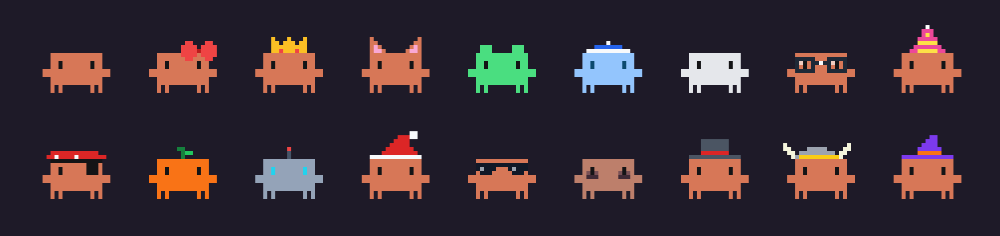
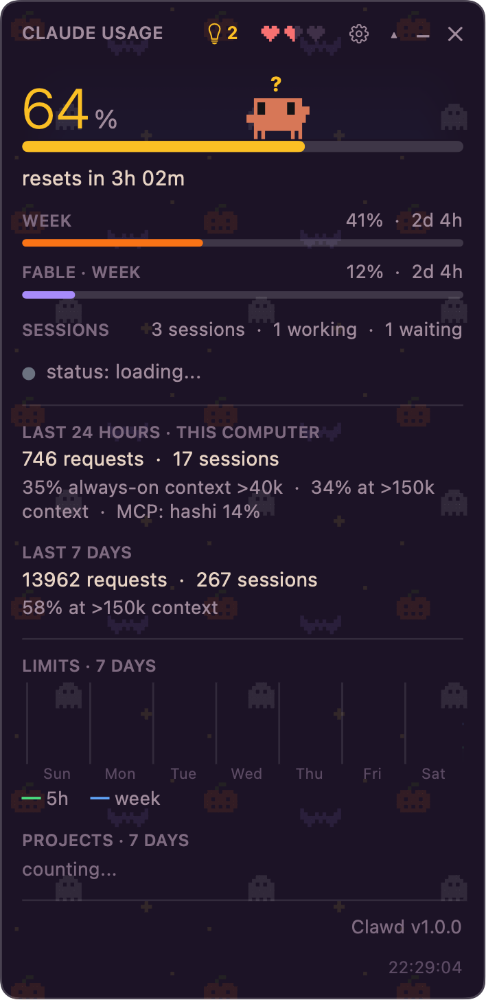
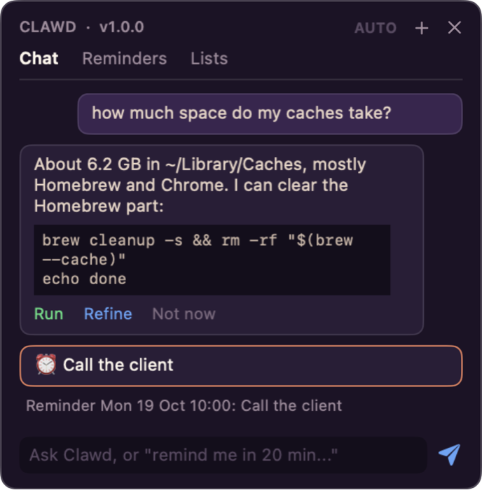
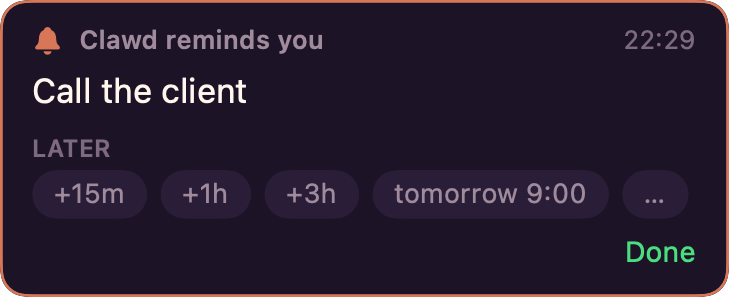

<p align="center">
  
</p>

<h1 align="center">Clawd Usage for macOS</h1>

<p align="center">
  <b>Your Claude plan limits in the menu bar, with a tiny crab who has opinions about them.</b>
</p>

---

Ever hit your 5-hour limit mid-thought? Clawd saw it coming. He sits in the menu bar and in a
little window on your desktop, keeps an eye on the same numbers `/usage` shows in Claude Code,
and acts out what your sessions are doing: he naps when nothing runs, scurries about while
Claude works, waves when a session is waiting on you, sweats as you near the limit, and flops
belly-up when it's all used up. Click him and he'll show off a move.

This is a native macOS port of [clawd-usage-winwidget](https://github.com/Enhed/clawd-usage-winwidget)
by [@Enhed](https://github.com/Enhed). It does the same things and uses the same file formats.

- **Official numbers only.** The percentages come from `claude -p /usage`. It runs headless,
  uses your existing login, and **does not call the model or spend tokens**.
- **No dependencies.** It is a single native app. You only need Claude Code itself.
- **Clawd.** The crab from Claude Code's welcome screen, with the same glyphs and animations,
  plus a wardrobe of 17 skins, live weather in his sky, and a chat panel where he can help
  tidy up your Mac.
- **Lives where you want.** Float it on top, or pin it to the desktop under your windows.

### The wardrobe



Pick one in Settings → Look, or draw your own: a skin is a small text file of pixels in
`~/Clawd/skins` (copy one from `Resources/skins` to start).

## Install

You need macOS 14 or later and [Claude Code](https://docs.claude.com/en/docs/claude-code),
installed and logged in.

### The easy way: download it

1. Grab `Clawd-Usage.dmg` from the [latest release](../../releases/latest).
2. Open it and drag **Clawd Usage** into **Applications**.
3. Open it from Applications. Clawd appears in the menu bar and on your screen.

The app is signed and notarized by Apple, so it opens without warnings. To have it start with
your Mac, turn on Settings → Window → Open at login.

### Build it yourself

With the Xcode command line tools (`xcode-select --install`):

```sh
git clone https://github.com/tso-89/clawd-usage-macwidget.git
cd clawd-usage-macwidget
scripts/install.sh               # builds the app and copies it to /Applications
open "/Applications/Clawd Usage.app"
```

A build of your own is signed only for your Mac. If you copy it to another one, right-click it and
choose Open the first time.

If Clawd can't find `claude`, set `claudePath` in
`~/Library/Application Support/ClawdUsage/config.json`.

## What's inside

<table><tr>
<td></td>
<td><br><br>
</td>
</tr></table>

- **Usage at a glance:** the 5-hour session, weekly and Fable limits, with reset times, plus
  your running Claude Code sessions and Claude's service status.
- **Details on demand:** requests and sessions over 24 hours and 7 days, a 7-day limits chart,
  and the projects that spent the most.
- **Clawd's panel:** Mac tips, a chat that answers with scripts you approve, reminders, lists,
  and recurring background tasks.
- **Sky and themes:** the real sun, moon and weather behind Clawd, and seven themes.

The [full tour](docs/FEATURES.md) covers every block, setting, data source and `config.json` key.

## Development

```sh
swift test                                   # unit + integration tests (a fake claude, no tokens)
scripts/build-app.sh && tools/smoke.sh       # build the app and check it starts
SIGN_ID=... NOTARY_PROFILE=... scripts/build-app.sh   # signed and notarized, plus dist/Clawd-Usage.dmg
.build/debug/ClawdUsage --render /tmp/out    # PNGs of every view with sample data, plus the README's GIF and skins
```

See [docs/ARCHITECTURE.md](docs/ARCHITECTURE.md).

## License

[MIT](LICENSE). Based on clawd-usage-winwidget (MIT).

---

Not affiliated with Anthropic. Clawd and Claude are Anthropic's.
