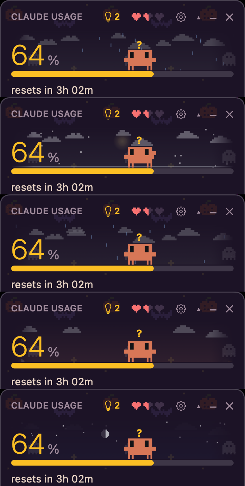
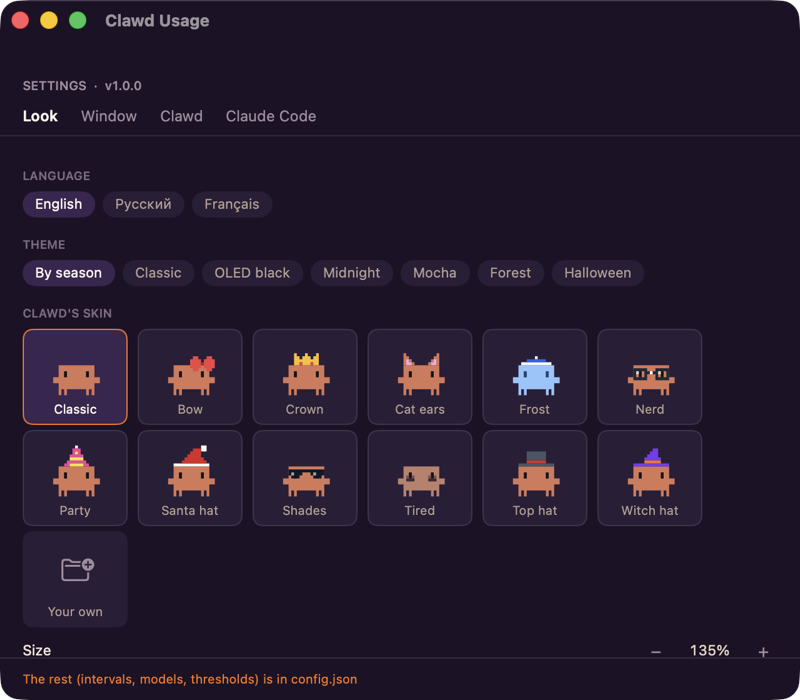

# Clawd Usage: the full tour

Everything the widget shows and does, in detail. Back to the [README](../README.md).

## What it shows

- **Menu bar.** A small pixel Clawd and the session percentage. The number turns yellow or red
  near the limit. Hover for the week and Fable limits.
  Click to show or hide the window. Right-click for refresh, settings and quit.
- **Big number.** The current session (the 5-hour window) and when it resets. The bar is green,
  then yellow from 60%, then red from 85%.
- **WEEK** and **FABLE · WEEK.** The weekly limits. The Fable row is hidden if `/usage` doesn't
  report it.
- **SESSIONS.** How many Claude Code sessions are running, working, or waiting for you. Hover
  for the list: `▶` working, `?` waiting (and what for), `○` idle, plus the folder. Sessions on
  other machines can be added with `remoteSessions` (the same feed format as upstream).
- **Service status** from status.claude.com. Click to open the page.
- **Bottom line.** Your plan and email (red "not logged in" if auth has expired) and the time of
  the last `/usage` answer, marked "stale" if it's old.

The ▾ in the header expands the details:

- **Last 24 hours / Last 7 days.** Requests, sessions and the "What's contributing to your
  limits usage?" breakdown from `/usage`.
- **Limits · 7 days** (`showHistory`). Both percentages over the last week. Hover for a moment's
  values and the busiest project in that hour.
- **Projects · 7 days.** The projects that spent the most this week, estimated from Claude Code's
  transcripts on this Mac.
- **Versions.** Your Claude Code version. It turns yellow when an update is out: hover for
  what's new, click to run `claude update`. The widget's own version is shown next to it.

### Clawd, the sky, themes and skins

Everything from upstream is here:

- the moods and one-shot animations: a finished session, the 5-hour window resetting with
  confetti, a click for a random animation and a heart, the soul leaving when he's belly-up;
- three hearts of health that change how he moves;
- developer mode (right-click him);
- the sky, following the real sun, moon phase and live weather (Open-Meteo, falling back to
  met.no; location from ipwho.is or `weatherLat`/`weatherLon`);
- seven themes, including Halloween with its wallpaper;
- seventeen skins (upstream's eleven plus pirate, Viking, ghost, robot, frog and pumpkin), plus
  your own `.txt` skins in `~/Clawd/skins` (see the upstream README for the format).

### Settings

The gear opens Settings, with four tabs:

- **Look:** language (English, Русский, Français), theme, skin, size, opacity.
- **Window:** always on top or pinned to the desktop, which blocks are shown, menu bar clock
  times, open at login.
- **Clawd:** tips, chat, recurring tasks, Clawd's own session.
- **Claude Code:** a picked set of keys from Claude Code's own `~/.claude/settings.json`. Only
  the key you change is rewritten, and the original file is kept as `settings.json.clawd-bak`.

### Clawd's panel: tips, chat, reminders, lists, tasks

The icon in the header opens a panel next to the widget.

- **Tips.** Every 30 minutes Clawd looks the Mac over, read-only and without network access.
  He checks for:
  - disks running out of space;
  - how much sits in Caches, Logs, the Trash, Downloads, npm, Xcode DerivedData and Gradle;
  - new launch agents;
  - apps not opened for 90+ days (from Spotlight's record);
  - a long uptime;
  - apps using a lot of memory or CPU.

  Each tip has **Do it**, **Refine** and **Dismiss**.
- **Chat.** Each message is a headless `claude -p` in Clawd's home (`~/Clawd`), with no write
  tools and read-only shell commands only. Changes come back as a **zsh** script that you see in
  full, with **Run**, **Refine** and **Not now**. **AUTO** runs scripts without the click, up to
  three in a row. **Full access** runs the chat in `bypassPermissions` mode.
- **Reminders** are files in `~/Clawd/reminders`, with the same format as upstream. The "when"
  field understands `18:30`, `tomorrow 10`, `+20m`, `mon 9:00`, `19.10 14:00`. Anything else is
  asked of a small model. A reminder that goes off shows a card in the top-right corner with
  snooze buttons, plus a notification.
- **Lists** are markdown checklists in `~/Clawd/lists`.
- **Recurring tasks** are files `~/Clawd/tasks/<name>.md` with `every:`/`at:`, `tools:`,
  `hours:`, `limit:` and `paused:`. They run in the background and stay quiet unless there's
  news. If a run is refused a permission, you get an **Allow** card. A task Clawd sets up
  from the chat never gets extra tools on its own: it asks with the same card first.
- **Clawd's own session** (`clawdSession`). The widget keeps an interactive
  `claude --remote-control` running in his home, so you can talk to him from the Claude app on
  your phone. It runs on a hidden terminal owned by the widget. If his folder hasn't been trusted
  yet, it opens once in Terminal so you can answer the trust prompt.

## Where the data comes from

| what | source | how often |
|---|---|---|
| limits and stats | `claude -p /usage --output-format text --no-session-persistence` | every 60 s |
| sessions | `~/.claude/sessions/<pid>.json` (live processes only) | every 10 s |
| account | `claude auth status` | every 10 min |
| latest Claude Code | `downloads.claude.ai/claude-code-releases/latest` (or `stable`) | hourly |
| status | `status.claude.com/api/v2/summary.json` | every 2 min |
| weather | Open-Meteo / met.no, location via ipwho.is | every 15 min |

`CLAUDE_CONFIG_DIR` is respected, the same way Claude Code respects it.

## config.json

The file is `~/Library/Application Support/ClawdUsage/config.json`, linked from the bottom of
Settings. Changes are picked up on the fly. The keys are the same as upstream's, with these
differences:

- **Added:**
  - `claudePath`: where `claude` is, if it isn't found automatically;
  - `updateRepo`: `owner/name` on GitHub, to announce new releases of this widget.
- **Dropped:** `runAsAdmin` and `clawdSessionAdmin`. macOS has no elevated GUI apps.
- **Changed:** `clawdHome` defaults to `~/Clawd`, and `left`/`top` are screen points from the top
  left.

## Differences from the Windows version

- The tray icon is a menu bar item, and Windows notifications are macOS notifications.
- Reminder cards appear in the top-right corner, where macOS shows its own notifications.
- Clawd's scripts are zsh, not PowerShell. The chat's read-only rules are `Bash(ls:*)`,
  `Bash(du:*)` and similar.
- Tips use macOS sources: Spotlight last-used dates, launch agents, Storage settings and
  Activity Monitor. There is no "pending restart" check, because macOS has no cheap equivalent.
- Self-update: a new release (with `updateRepo` set) is announced once and opens its page. Files
  are not replaced in place, because an unsigned app would be quarantined. See
  [ADR 0001](ADR/0001-native-swift.md).
